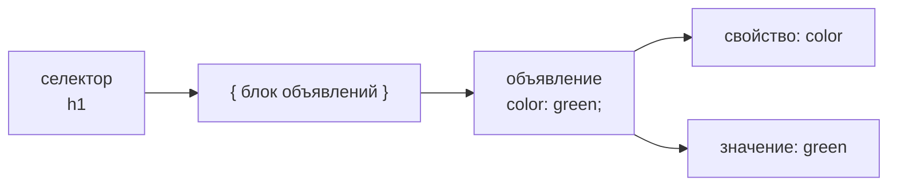
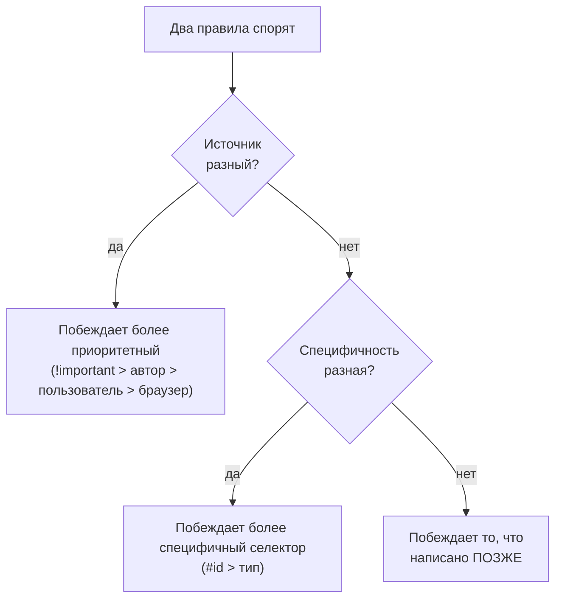
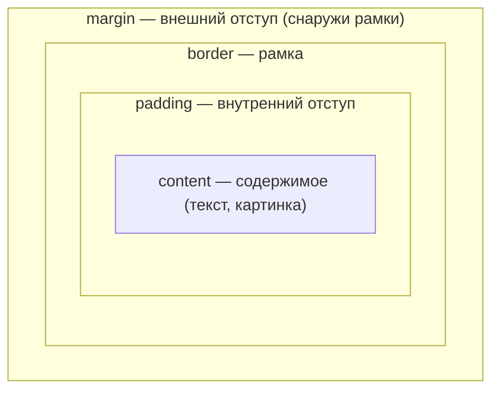

# Лекция 1. Основы CSS

> [!abstract] Цель лекции
> К концу часа студент **читает и пишет простые CSS-правила**, знает **три способа подключить стили**, понимает, **почему одно правило побеждает другое** (наследование, каскад, специфичность, порядок), имеет базовое представление о **блочной модели** и **единицах измерения**, умеет **подсмотреть стили через DevTools**.

> [!info] Как пользоваться конспектом
> - 🗣 — то, что можно говорить своими словами (текст можно читать почти дословно).
> - 💻 — живая демонстрация в редакторе и браузере.
> - ❓ — вопрос аудитории.
> - ⏱ — ориентир по времени. Сумма = 60 минут. Если идёте быстрее, добавляйте вопросы и упражнения; если медленнее — пропустите блок «Если остаётся время».

## План и тайминг

| # | Блок | Время |
|---|------|-------|
| 0 | Зачем нужен CSS | 5 мин |
| 1 | Анатомия правила: селектор, свойство, значение | 10 мин |
| 2 | Три способа подключить стили | 8 мин |
| 3 | Дерево документа и наследование | 9 мин |
| 4 | Каскад: приоритет, специфичность, порядок | 10 мин |
| 5 | Блочная модель (первое знакомство) | 5 мин |
| 6 | Единицы измерения | 7 мин |
| 7 | DevTools — лучший друг верстальщика | 4 мин |
| 8 | Итоги и проверка себя | 2 мин |

---

## Подготовка к лекции (до начала)

Создайте файл `demo.html` — на нём будем строить все примеры. Весь CSS пишем в `<style>` внутри `<head>`.

```html
<!DOCTYPE html>
<html lang="ru">
<head>
  <meta charset="utf-8">
  <title>Салаты</title>
  <style>
    /* сюда будем писать правила */
  </style>
</head>
<body>
  <h1>Летние салаты</h1>
  <p id="intro">Свежие салаты — это <em>просто</em> и полезно.</p>
  <p>Второй абзац, в котором тоже есть <em>выделенное слово</em>.</p>
  <h2>Основное блюдо</h2>
  <p>Ещё один абзац с обычным текстом.</p>
  <h2>Десерт</h2>
  <p>Последний абзац.</p>
</body>
</html>
```

Откройте файл в браузере и редакторе рядом (два окна). Покажите аудитории страницу **до** стилей — «голый» HTML.

---

## 0. Зачем нужен CSS ⏱ 5 мин

🗣 «Добрый день! Сегодня первая из трёх лекций по CSS. Задача трёх лекций — дать вам **минимум**, с которым вы сможете оформить простую страницу и, главное, понимать, что вы делаете. Мы не будем учить всё подряд: в CSS сотни свойств, но для старта хватает десятка-двух и нескольких ключевых идей. Эти идеи — сегодня.»

### Структура и оформление — это разные вещи

🗣 «Вспомним HTML. Что он делает? Он описывает **структуру и смысл**: вот заголовок, вот абзац, вот список, вот выделенное слово. HTML отвечает на вопрос *«что это?»*. А вот на вопрос *«как это выглядит?»* отвечает **CSS** — Cascading Style Sheets, каскадные таблицы стилей.»

> [!note] Определение
> **CSS** — стандарт консорциума W3C, который описывает **представление** (презентацию) документа, написанного на HTML: цвета, шрифты, отступы, расположение блоков. Представление — это то, как документ подаётся пользователю: на экране компьютера, смартфона, на бумаге или голосом через программу экранного доступа.

| Слой | Язык | Отвечает на вопрос |
|------|------|--------------------|
| Структура | HTML | Что это за содержимое? |
| Представление | CSS | Как оно выглядит? |

### Что мы получаем, разделяя их

- **Меньше работы.** Меняем один файл стилей — меняется вид всего сайта. Все страницы выглядят единообразно.
- **Доступность.** HTML размечен по смыслу, а не «ради внешнего вида» — его лучше понимают программы экранного чтения и поисковые системы.
- **Серьёзный дизайн.** Современный CSS умеет сетки, продвинутую типографику, анимации и подстройку под разные экраны.

### Демонстрация силы CSS

🗣 «Есть знаменитый сайт **CSS Zen Garden** (csszengarden.com), он появился в 2003 году. Автор выложил один и тот же HTML-документ и предложил дизайнерам со всего мира написать для него свои стили. В результате — десятки совершенно разных сайтов, которые **не отличаются ни одним символом HTML**. Даже картинки там вставлены не тегами ``, а фоном элементов. Всё различие — только в CSS. Если останется время после лекции — зайдите и посмотрите.»

💻 *(По желанию: откройте csszengarden.com и переключите 2–3 дизайна. 1 минута.)*

❓ «Как думаете, если у сайта на 500 страниц нужно поменять цвет заголовков — сколько файлов придётся править, если стили вынесены отдельно?» → *Один.*

---

## 1. Анатомия правила ⏱ 10 мин

🗣 «Таблица стилей состоит из **правил**. Правило — это одна инструкция: «вот эти элементы должны выглядеть вот так».»

```css
h1 { color: green; }
p  { font-size: large; font-family: sans-serif; }
```

🗣 «Здесь два правила. Первое делает все заголовки `h1` зелёными. Второе делает все абзацы крупными и шрифтом без засечек. *Засечки* — это маленькие «чёрточки» на концах штрихов букв; шрифт без засечек выглядит современнее и проще.»

### Из чего состоит правило

```css
селектор {
  свойство1: значение1;
  свойство2: значение2;
}
```



| Часть | Что это | Пример |
|-------|---------|--------|
| **Селектор** | *К чему* применяется правило | `h1` |
| **Блок объявлений** | Всё внутри фигурных скобок | `{ ... }` |
| **Объявление** | Одна пара «свойство — значение» | `color: green;` |
| **Свойство** | *Что* меняем | `color` |
| **Значение** | *На что* меняем | `green` |

🗣 «Свойство и значение разделяются **двоеточием**, а каждое объявление заканчивается **точкой с запятой**.»

> [!warning] Главная ошибка новичков
> Забытая `;` или `}`. Если пропустить точку с запятой, **это объявление и следующее за ним будут проигнорированы**. Браузер не выдаст ошибку — стиль просто «не сработает». Привычка: **всегда** ставить `;`, даже после последнего объявления — так проще добавлять новые строки.

### Форматирование

🗣 «CSS игнорирует пробелы и переводы строк внутри блока. Поэтому принято писать **каждое объявление на отдельной строке** — так правило легче читать:»

```css
p {
  font-size: large;
  font-family: sans-serif;
}
```

### Комментарии

```css
/* Это комментарий — браузер его пропускает */
body {
  font-size: small;
  /* потом поменяю */
}
```

🗣 «Комментарии нужны, чтобы подписывать разделы (`/* ШАПКА */`, `/* ПОДВАЛ */`) и чтобы **временно отключать** строки при экспериментах: закомментировали, посмотрели результат, раскомментировали.»

### Селекторы: минимум на сегодня

Сегодня нужны всего три вида.

**1. Селектор типа (по имени тега)** — самый простой. Правило действует на **все** элементы этого типа:

```css
p { color: gray; }
```

**2. Группа селекторов** — чтобы не повторяться, перечисляем через **запятую**:

```css
h1, h2, p, em { border: 1px solid blue; }
```

🗣 «Эта запись заменяет четыре отдельных правила. Файл короче, править удобнее.»

**3. Селектор по `id`** — выбирает один конкретный элемент по его атрибуту `id`. Обозначается значком `#`:

```css
#intro { color: purple; }
```

```html
<p id="intro">…</p>
```

> [!tip] Заглядываем вперёд
> В следующей лекции мы добавим **селекторы по классу** (`.название`) — самый частый инструмент в реальной работе. Пока достаточно знать, что селекторы бывают разные и что **выбирать селектор правильно — половина мастерства в CSS**.

### Значения

🗣 «Какие значения допустимы — зависит от свойства. Одни свойства принимают **размеры** (`12px`), другие — **цвета** (`green`), третьи — **ключевые слова** (`large`, `sans-serif`). Если не помните — подсказывают редакторы кода, и всегда есть справочник MDN.»

### 💻 Практика (≈3 мин)

Впишите в `<style>`:

```css
h1 {
  color: green;
}
p {
  font-size: large;
  font-family: sans-serif;
}
```

Сохраните, обновите страницу (`Ctrl+S`, затем `F5`). Затем вместе с аудиторией:

1. Покрасьте `h2` в `maroon` (бордовый).
2. Добавьте абзацам левый отступ: `margin-left: 100px;`.
3. Сделайте рамку у `h1`: `border-bottom: 1px solid maroon;` и `padding: 12px;`.

🗣 «Видите, как быстро всё меняется? Каждый раз: правка → сохранить → обновить → смотрим.»

❓ «Что произойдёт, если в `p { font-size: large font-family: sans-serif; }` забыть `;` между объявлениями?» → *Оба объявления будут проигнорированы.*

---

## 2. Три способа подключить стили ⏱ 8 мин

🗣 «Мы только что писали стили прямо в HTML-файле. Это один из **трёх способов**. Давайте разберём все три и решим, каким пользоваться.»

### 2.1. Внешний файл (external) — основной способ

Отдельный текстовый файл с расширением `.css`, в котором лежат только правила. В HTML он подключается тегом `<link>` в `<head>`:

```html
<head>
  <link rel="stylesheet" href="styles.css">
</head>
```

```css
/* styles.css */
h1 { color: green; }
p  { font-size: large; }
```

> [!success] Почему это лучший способ
> Один файл стилей подключается ко **всем** страницам сайта. Поменяли в нём — поменялся весь сайт. Браузер ещё и запоминает файл (кеширует), страницы грузятся быстрее.

Внутри CSS-файла можно подтянуть другой файл правилом `@import url(other.css);` — но на практике чаще используют несколько тегов `<link>`.

### 2.2. Встроенные стили (embedded)

Правила пишутся внутри элемента `<style>`, который **обязан** находиться в `<head>`:

```html
<head>
  <style>
    h1 { color: green; }
  </style>
</head>
```

🗣 «Работает только для **одной** страницы. Удобно для учебных примеров и быстрых экспериментов — именно поэтому мы так делаем на лекции.»

### 2.3. Встроенные в тег (inline)

Атрибут `style` прямо у элемента:

```html
<h1 style="color: red; margin-top: 2em;">Введение</h1>
```

🗣 «Влияет **только** на этот один элемент. Несколько свойств разделяем `;`.»

> [!danger] Почему inline-стили — плохая практика
> Они **смешивают оформление со структурой** — ровно то, от чего мы хотели уйти. И их неудобно менять: нужно искать каждый `style=""` по всему коду. Применять — только в редких случаях, когда нужно **перебить** другое правило. (Замечание: некоторые фреймворки, например Tailwind, наоборот, строятся вокруг такого подхода — но это сознательный компромисс ради удобства.)

### Сравнение

| Способ | Где пишется | На что влияет | Когда использовать |
|--------|-------------|---------------|--------------------|
| Внешний | Файл `.css` + `<link>` | Все страницы сайта | **Всегда по умолчанию** |
| Встроенный | `<style>` в `<head>` | Одна страница | Учебные примеры, прототипы |
| Inline | Атрибут `style` | Один элемент | Редко, в исключительных случаях |

### 💻 Практика (≈2 мин)

1. Вынесите правила из `<style>` в файл `styles.css` рядом с `demo.html`.
2. Подключите его через `<link>`.
3. Убедитесь, что страница выглядит так же.
4. Добавьте второму `h2` inline-стиль `style="color: orange;"` — увидите, что он «перебивает» бордовый. **Запомните этот эффект — к нему мы вернёмся через несколько минут.**

---

## 3. Дерево документа и наследование ⏱ 9 мин

🗣 «Теперь — первая «большая идея» CSS. Она объясняет, почему вы красите один элемент, а меняются и вложенные в него.»

### 3.1. Документ — это дерево

HTML-документ имеет иерархию: корневой элемент `html` содержит `head` и `body`, `body` содержит заголовки и абзацы, абзацы могут содержать `em`, `strong`, `img` и т. д. Это называется **DOM** (Document Object Model).

```mermaid
graph TD
  html --> head
  html --> body
  head --> title
  head --> style
  body --> h1
  body --> p1["p #intro"]
  body --> h2
  body --> p2["p"]
  p1 --> em1["em"]
  p2 --> em2["em"]
```

### 3.2. Семейные отношения

| Термин | Значение | Пример |
|--------|----------|--------|
| **Потомок** (descendant) | Любой элемент, вложенный внутрь | `em` — потомок `body` |
| **Ребёнок** (child) | Вложен *непосредственно*, без промежуточных уровней | `em` — ребёнок `p` |
| **Родитель** (parent) | Элемент, который непосредственно содержит данный | `p` — родитель `em` |
| **Предок** (ancestor) | Любой элемент выше по дереву | `body` — предок `em` |
| **Сёстры/братья** (siblings) | Элементы с одним родителем | два `p` в `body` |

🗣 «Про «двоюродных» и «тётушек» CSS не говорит, аналогия на этом заканчивается. Но эти слова нам скоро пригодятся — в селекторах.»

### 3.3. Наследование

🗣 «Как дети наследуют от родителей цвет глаз, так и элементы **наследуют от родителей** некоторые свойства оформления. Посмотрите на наш пример: мы задали **абзацам** крупный шрифт без засечек. А слово внутри `<em>`? Мы для `em` ничего не писали, но оно тоже крупное и без засечек. Почему? Потому что `em` — ребёнок `p` и **унаследовал** шрифтовые свойства.»

💻 Покажите на странице: `em` в абзаце имеет такой же шрифт, как весь абзац.

> [!important] Правило наследования
> Наследуется **не всё**.
> - **Наследуются** свойства, связанные с **текстом**: цвет текста, размер и семейство шрифта, начертание, межстрочный интервал.
> - **Не наследуются** свойства **«коробки»**: рамки, отступы, фон.

🗣 «Это логично: если вы поставите рамку вокруг абзаца, вам не нужны отдельные рамки вокруг каждого `<em>` и `<a>` внутри него!»

### 3.4. Как использовать наследование

Хотите, чтобы весь текст на странице был синим? Не нужно писать правило для каждого элемента. Достаточно одного:

```css
body { color: blue; }
```

Все элементы внутри `body` унаследуют этот цвет.

И обратное: **собственное правило всегда сильнее унаследованного**. Если дальше написать

```css
em { color: orange; }
```

то `em` будет оранжевым, несмотря на синий цвет, унаследованный от родителя.

> [!tip] Полезная привычка
> Изучая новое свойство, сразу выясняйте: **наследуется оно или нет**. В справочниках (MDN) это указывается для каждого свойства.

### 💻 Практика (≈2 мин)

1. Уберите правила для `p`. Вместо них напишите `body { font-family: sans-serif; color: #333; }`. Страница целиком сменила шрифт и цвет.
2. Добавьте `em { color: orange; }`. Только выделенные слова стали оранжевыми.

❓ «Если написать `p { border: 1px solid blue; }`, появится ли рамка вокруг `<em>` внутри абзаца?» → *Нет, рамка не наследуется.*

---

## 4. Каскад: кто побеждает, когда правила спорят ⏱ 10 мин

🗣 «Почему стили называются **каскадными**? Потому что к одному элементу могут применяться правила **из нескольких источников одновременно**, и они могут **противоречить** друг другу. Например, во внешнем файле `h1` красный, а во встроенном `<style>` — фиолетовый. Что выбрать браузеру? Для этого есть чёткая система «весов». Она учитывает три вещи:»

1. **Приоритет источника** (откуда пришло правило);
2. **Специфичность селектора** (насколько он точный);
3. **Порядок правил** (что написано позже).

Читать нужно именно в таком порядке: сначала смотрим на источник, при равенстве — на специфичность, при равенстве — на порядок.

### 4.1. Приоритет источника

Стили приходят из трёх мест:

| Источник | Кто пишет |
|----------|-----------|
| Таблица стилей **браузера** (user agent) | Разработчики браузера — «стандартный вид» страницы без CSS |
| Таблица стилей **пользователя** | Сам читатель (например, для крупного шрифта) |
| Таблица стилей **автора** | **Вы** — разработчик страницы |

🗣 «Если вы написали стиль, он перебивает стандартные стили браузера — поэтому наши правила вообще работают.»

Исключение — маркер **`!important`**:

```css
p { color: blue !important; }
```

> [!warning] Про `!important`
> Правило с `!important` нельзя перебить обычными правилами автора — даже inline-стилем. Но это **не волшебная кнопка**: если использовать её, чтобы «заставить работать», потом сложно что-либо менять. Пользователи с нарушениями зрения могут пометить `!important` свои стили (крупный шрифт, высокий контраст) — и это правильно: так их настройки сильнее ваших. **Правило хорошего тона: не использовать `!important` вообще, пока нет веской причины.**

### 4.2. Специфичность

🗣 «Если два правила одного источника спорят, побеждает то, у которого селектор **точнее**.»

```css
p       { color: green; }
#intro  { color: purple; }
```

```html
<p id="intro">Первый абзац</p>
<p>Второй абзац</p>
```

🗣 «Абзац с `id="intro"` подпадает под оба правила. Но селектор по `id` **специфичнее**, чем селектор по типу, поэтому первый абзац будет **фиолетовым**, остальные — зелёными.»

> [!note] Шкала специфичности (от слабого к сильному)
> селектор типа (`p`) **<** селектор класса (`.note`, в лекции 2) **<** селектор `#id` **<** inline-стиль `style=""`
>
> Подробности — позже. Пока запомните идею: **чем точнее указан элемент, тем больше вес.**

💻 Вернитесь к примеру с оранжевым `h2`: inline-стиль перебил правило из `<style>` — потому что он самый «точный».

### 4.3. Порядок правил: «побеждает последнее»

🗣 «Если источник и специфичность одинаковы — решает порядок. Правило, **написанное ниже, побеждает**.»

```css
p { color: red; }
p { color: blue; }
p { color: green; }
```

Абзацы будут **зелёными**. То же самое внутри одного правила:

```css
p {
  color: red;
  color: blue;
  color: green;
}
```

Тоже зелёный: последнее объявление перекрывает предыдущие.

> [!tip] Приём «запасной вариант» (fallback)
> Браузер **молча игнорирует** объявления, которых он не понимает. Это позволяет страховаться:
> ```css
> div {
>   background-color: yellow;   /* запасной вариант */
>   texture: bumpy;             /* новое «придуманное» свойство */
> }
> ```
> Браузер, который знает `texture`, применит его (оно ниже и «выигрывает»). Тот, который не знает, пропустит строку и останется с жёлтым фоном. Сначала — надёжное, потом — новое.

### 4.4. Всё вместе: пример

```html
<head>
  <style>
    @import url(external.css);  /* внутри: h1 { color: red } */
    h1 { color: purple; }
  </style>
</head>
<body>
  <h1 style="color: blue">Заголовок 1</h1>
  <h1>Заголовок 2</h1>
</body>
```

🗣 «Давайте проследим, как браузер идёт по документу. Сначала импортирует внешний файл — `h1` красные. Потом встречает собственное правило в `<style>` — оно такого же веса и стоит позже, значит, `h1` фиолетовые. И, наконец, у первого `h1` есть inline-стиль — он приоритетнее, и этот заголовок синий. **Итог: первый — синий, второй — фиолетовый.**»

### Шпаргалка по каскаду



❓ **Мини-тест:** «Какого цвета будет абзац?»
```css
p { color: purple; }
p { color: green; }
p { color: gray; }
```
→ *Серого: источник и специфичность одинаковы, побеждает последнее правило.*

---

## 5. Блочная модель (первое знакомство) ⏱ 5 мин

🗣 «Вторая «большая идея». Она — основа всей раскладки в CSS. Браузер видит **каждый элемент страницы как прямоугольную коробку** — и блочные (заголовки, абзацы), и строчные (`em`, `img`, `a`).»

💻 Покажите наглядно: добавьте правило

```css
h1, h2, p, em, img { border: 1px solid blue; }
```

🗣 «Вот так браузер «видит» страницу — рамки обнаружили **коробки**. Заметьте: блочные элементы (`h1`, `p`) растягиваются **на всю доступную ширину**, а строчные (`em`) занимают ровно столько места, сколько нужно тексту.»

### Из чего состоит коробка



| Слой | Назначение | Свойство |
|------|-----------|----------|
| **Content** | Сам текст/картинка | `width`, `height` |
| **Padding** | Воздух **между** содержимым и рамкой | `padding` |
| **Border** | Рамка | `border` |
| **Margin** | Воздух **вокруг** рамки, расстояние до соседей | `margin` |

🗣 «Запомнить удобно так: **padding** — «подушка» внутри (как мягкая обивка вокруг содержимого), **margin** — расстояние, которое мы держим от соседей.»

```css
h1 {
  border-top: 1px solid maroon;
  border-bottom: 1px solid maroon;
  padding: 12px;       /* внутри */
  margin-left: 100px;  /* снаружи */
}
```

> [!info] Что дальше
> Детальный разбор блочной модели и раскладки — в **лекции 3**. Сегодня важно уже понимать картинку: **любой элемент — это коробка с содержимым, внутренним отступом, рамкой и внешним отступом**. Этот образ пригодится в оформлении текста и фонов в лекции 2.

---

## 6. Единицы измерения ⏱ 7 мин

🗣 «Размеры в CSS задаются числом **и единицей**: `12px`, `1.5rem`, `50%`. Ноль можно писать без единицы. Единицы делятся на **абсолютные** и **относительные**.»

### 6.1. Абсолютные: пиксель

- **`px`** — пиксель (в CSS по определению 1/96 дюйма). Единственная абсолютная единица, которая вам реально нужна на экране.
- `pt`, `pc`, `in`, `cm`, `mm` — «бумажные» единицы, для экрана почти бесполезны (пригодятся в стилях для печати).

🗣 «Пиксели — понятные и привычные, но «жёсткие»: они не подстраиваются ни под размер экрана, ни под настройки читателя. Их уместно применять там, где размер **действительно** не должен меняться: толщина рамок (`1px`), картинки с фиксированным размером.»

### 6.2. Относительные: гибкие

Они считаются от **чего-то другого**, поэтому страница лучше подстраивается под устройство и настройки пользователя. Для большинства размеров используют именно их.

**`rem`** — «корневой em». Считается от размера шрифта корневого элемента `html`. В современных браузерах по умолчанию он равен **16px**.

| Запись | Результат при базе 16px | Если пользователь поставил 24px |
|--------|------------------------|--------------------------------|
| `1rem` | 16px | 24px |
| `10rem` | 160px | 240px |

🗣 «Если пользователь увеличил шрифт в настройках браузера — всё, что вы задали в `rem`, увеличится вместе с ним. Это не баг, а **функция**: страница остаётся пропорциональной тексту.»

**`em`** — равен размеру шрифта **текущего элемента**. Для текста 16px: `1em = 16px`, для 24px: `1em = 24px`.

> [!warning] Ловушка `em`
> `em` всегда считается **от шрифта именно этого элемента**. Если написать `margin-left: 2em` и у `h1`, и у `h2`, и у `p`, отступы получатся **разными** — ведь размеры шрифтов у них разные, и выровнять колонки не получится. Для начала проще использовать `rem` — там база одна.

**Проценты (`%`)** — считаются от другого значения (чаще всего от размера родителя). В спецификации для каждого свойства сказано, от чего именно.

**`vw` и `vh`** — доли окна браузера (viewport): `1vw` = 1/100 ширины окна, `1vh` = 1/100 высоты.

```css
header {
  width: 100vw;   /* на всю ширину окна */
  height: 50vh;   /* половина высоты окна */
}
```

> [!note] Деталь про наследование
> Потомки наследуют не саму запись вроде `2em`, а **уже вычисленное** значение в пикселях.

### 6.3. Быстрое правило выбора

| Что задаём | Чем пользоваться |
|-----------|------------------|
| Размер шрифта, отступы, ширины блоков | `rem` (или `em`, `%`) |
| Рамки, мелкие «жёсткие» детали | `px` |
| Блок на весь экран / часть экрана | `vw`, `vh` |

❓ «Базовый шрифт 16px. Сколько пикселей в `2.5rem`?» → *40.*

---

## 7. DevTools — инструменты разработчика ⏱ 4 мин

🗣 «Из-за каскада на элемент действуют стили из многих источников, и легко запутаться — почему мой абзац не такого цвета? Для этого в **каждом** браузере есть встроенные инструменты разработчика. Это ваш главный помощник.»

**Как открыть**

| Браузер | Способ |
|---------|--------|
| Chrome / Edge / Opera | `F12` или `Ctrl+Shift+I` |
| Firefox | `F12` |
| Safari | Develop → Show Web Inspector |

Или: **правая кнопка мыши на элементе → «Просмотреть код» / «Inspect»**.

### Что показывают

- Вкладка **Elements** — HTML-дерево страницы. Клик по элементу подсвечивает его на странице.
- Панель **Styles** — **все правила**, действующие на выбранный элемент, включая стили браузера по умолчанию. Перечёркнутые строки — правила, которые **проиграли** в каскаде. Вот где можно увидеть всё, о чём мы говорили в блоке 4!
- Внизу панели Styles — **схема блочной модели** с размерами content, padding, border, margin.
- Любое значение **можно менять прямо в панели** — страница обновляется мгновенно.

> [!warning] Важно
> Изменения в DevTools — **только предпросмотр**. Они не сохраняются в файл. Понравилось — перенесите в код вручную.

### 💻 Демонстрация (≈3 мин)

1. Откройте `demo.html` → правый клик по заголовку → Inspect.
2. Покажите перечёркнутые правила (например, `color: red`, которое победило `green`, если вы ещё не убрали из кода).
3. Измените `color` у `h1` в панели — страница меняется сразу.
4. Покажите диаграмму блочной модели у абзаца.
5. Откройте любой реальный сайт и посмотрите на его стили — **можно и нужно подглядывать**: ничего не сломается, это только ваша копия страницы.

---

## 8. Итоги и проверка себя ⏱ 2 мин

### Что нужно унести с лекции

1. **HTML** — структура, **CSS** — оформление. Их нужно разделять.
2. Правило = **селектор** `{ свойство: значение; }`. Не забываем `;`.
3. Стили подключаем из **внешнего `.css`-файла** через `<link>`. `<style>` — для примеров, inline — почти никогда.
4. **Наследование:** текстовые свойства (цвет, шрифт) передаются от родителя к детям; рамки, отступы и фон — нет.
5. **Каскад:** при конфликте смотрим на **источник → специфичность → порядок** («последнее побеждает»).
6. Любой элемент — **коробка**: content + padding + border + margin.
7. Размеры: `px` для мелочей, **`rem`/`em`/`%`** для гибкости, `vw`/`vh` для долей экрана.
8. Если стиль «не работает» — открой **DevTools**.

### Проверьте себя (разбор в конце)

**Вопрос 1.** Назовите части правила `blockquote { line-height: 1.5; }`.

**Вопрос 2.** Каким будет цвет абзацев?
```css
p { color: purple; }
p { color: green; }
p { color: gray; }
```

**Вопрос 3.** Исправьте и перепишите короче:

```css
/* a */
p { font-family: sans-serif; }
p { font-size: 1em; }
p { line-height: 1.2em; }

/* b */
blockquote {
  font-size: 1em
  line-height: 150%
  color: gray }

/* c */
body
  { background-color: black; }
  { color: #666; }
  { margin-left: 12em; }
  { margin-right: 12em; }

/* d */
p { color: white; }
blockquote { color: white; }
li { color: white; }
```

```html
<!-- e -->
<strong style="red">Act now!</strong>
```

**Вопрос 4.** Дано дерево: `body` → `h1`, `div#intro` (внутри: `p` → `img`, `strong`; `ul` → три `li`), `div#main` (внутри: `h2`, `p`, `h2`, `p`). Какие элементы станут красными при правиле `div#intro { color: red; }`?

<details>
<summary>Ответы</summary>

**1.** Селектор — `blockquote`; свойство — `line-height`; значение — `1.5`; объявление — `line-height: 1.5;`.

**2.** Серый — последнее правило перекрывает предыдущие (одинаковые источник и специфичность).

**3.**
- a: объединить в одно правило:
  ```css
  p {
    font-family: sans-serif;
    font-size: 1em;
    line-height: 1.2em;
  }
  ```
- b: нет `;` после первых двух объявлений, закрывающая скобка:
  ```css
  blockquote {
    font-size: 1em;
    line-height: 150%;
    color: gray;
  }
  ```
- c: объявления должны быть в **одном** блоке `{}`:
  ```css
  body {
    background-color: black;
    color: #666;
    margin-left: 12em;
    margin-right: 12em;
  }
  ```
- d: сгруппировать селекторы:
  ```css
  p, blockquote, li { color: white; }
  ```
- e: в атрибуте нужно указать свойство: `<strong style="color: red;">Act now!</strong>`

**4.** Красными (унаследуют цвет) будут все элементы **внутри** `div#intro` и сам `div#intro`: текст самого `div`, `p`, `strong`, `ul`, три `li`. (`img` не содержит текста, поэтому цвета не покажет.) `h1`, `div#main` и всё внутри него — не затронуты.
</details>

---

## Домашнее задание (необязательное, для закрепления)

1. Возьмите `demo.html`, вынесите стили во внешний файл `styles.css`.
2. Сделайте: заголовок `h1` — зелёный с рамкой сверху и снизу; `h2` — бордовые; абзацы — шрифт без засечек, размер `1.1rem`.
3. Задайте цвет текста один раз на `body` и переопределите его для `em`.
4. С помощью DevTools найдите правило, которое победило, и правило, которое проиграло, — сделайте скриншот.

---

## Если остаётся время (резерв ~5 мин)

- Живой пример «сломайте и найдите»: нарочно уберите `;` в одном правиле и попросите аудиторию найти ошибку в DevTools.
- Ещё раз разобрать каскад на «хитром» примере: `p { color: red !important; }` + `#intro { color: blue; }` + inline `style="color: green"` → какой цвет? (*красный — `!important` сильнее всех*).
- Показать `csszengarden.com` подробнее.

---

> [!quote] Мост к следующей лекции
> 🗣 «Сегодня мы разобрались, **как устроен** CSS: как писать правила, откуда стили приходят и как они конкурируют. В **лекции 2** займёмся самим оформлением — шрифтами, цветом текста, фоном, и добавим самый нужный селектор — по классу.»
>
> → [[CSS Лекция 2 — Текст, цвет и фон]]
