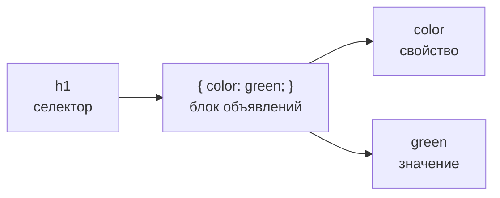
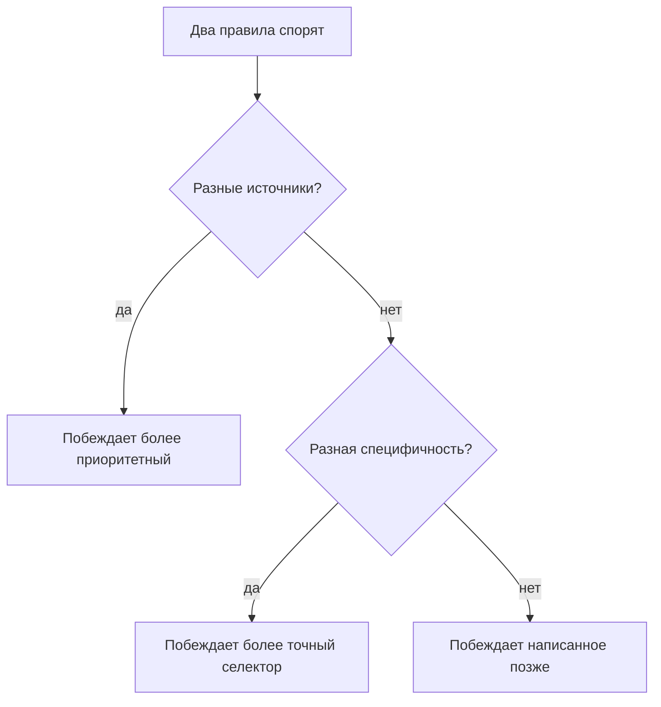
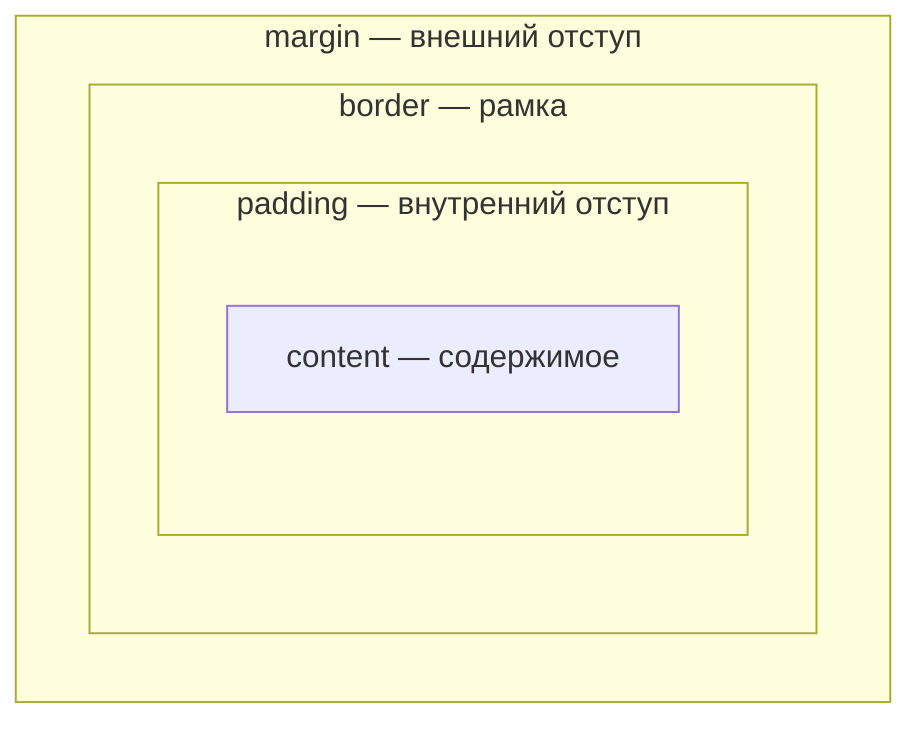

<br><br><br>

# CSS
## Лекция 1. Основы

> [!abstract] О чём лекция
> Как писать правила, подключать стили и понимать, какое из них победит

<div style="page-break-after: always;"></div>

## План

1. Зачем нужен CSS
2. Правило: селектор, свойство, значение
3. Три способа подключить стили
4. Наследование
5. Каскад
6. Блочная модель
7. Единицы измерения
8. DevTools

<div style="page-break-after: always;"></div>

## HTML и CSS

| | Язык | Отвечает на вопрос |
|---|---|---|
| Структура | **HTML** | Что это? |
| Оформление | **CSS** | Как выглядит? |

> [!note] Определение
> **CSS** — Cascading Style Sheets, каскадные таблицы стилей. Стандарт W3C для описания внешнего вида HTML-документов.

<div style="page-break-after: always;"></div>

## Зачем разделять структуру и оформление

> [!success] Меньше работы
> Правим один файл — меняется весь сайт

> [!success] Доступность
> Разметка по смыслу понятна программам чтения с экрана и поисковикам

> [!success] Богатый дизайн
> Сетки, шрифты, анимации, адаптация под разные экраны

<div style="page-break-after: always;"></div>

## CSS Zen Garden

Один и тот же HTML-документ — десятки разных дизайнов.

Все отличия — **только в стилях**. Ни одного тега ``: картинки заданы фоном.

🔗 csszengarden.com

<div style="page-break-after: always;"></div>

<br><br><br>

# 1. Правило

<div style="page-break-after: always;"></div>

## Пример

```css
h1 {
  color: green;
}

p {
  font-size: large;
  font-family: sans-serif;
}
```

- Все `h1` — зелёные
- Все абзацы — крупные, шрифт без засечек

<div style="page-break-after: always;"></div>

## Анатомия правила

```css
селектор {
  свойство: значение;
}
```

| Часть | Что это |
|---|---|
| **Селектор** | К чему применяем |
| **Свойство** | Что меняем |
| **Значение** | На что меняем |
| **Объявление** | Пара `свойство: значение;` |

<div style="page-break-after: always;"></div>

## Схема правила



<div style="page-break-after: always;"></div>

## Не забывай

- Двоеточие между свойством и значением
- **Точка с запятой** после каждого объявления
- Фигурные скобки `{ }` вокруг блока

> [!warning] Частая ошибка
> Пропущена `;` — это объявление и следующее за ним **не сработают**

<div style="page-break-after: always;"></div>

## Комментарии

```css
/* Это комментарий */
body {
  font-size: small;
  /* потом поменяю */
}
```

Браузер их пропускает. Удобно подписывать разделы и временно отключать строки.

<div style="page-break-after: always;"></div>

## Селекторы

**По тегу** — все элементы этого типа

```css
p { color: gray; }
```

**Группа** — через запятую

```css
h1, h2, p { color: gray; }
```

**По id** — один конкретный элемент

```css
#intro { color: purple; }
```

```html
<p id="intro">...</p>
```

<div style="page-break-after: always;"></div>

## Практика

Добавьте в `<style>`:

```css
h2 { color: maroon; }

p { margin-left: 100px; }

h1 {
  border-bottom: 1px solid maroon;
  padding: 12px;
}
```

> [!tip] Цикл работы
> Сохранить → обновить страницу → посмотреть результат

<div style="page-break-after: always;"></div>

<br><br><br>

# 2. Подключение стилей

<div style="page-break-after: always;"></div>

## Три способа

1. **Внешний файл** `.css`
2. **Встроенный** — элемент `<style>`
3. **Inline** — атрибут `style`

<div style="page-break-after: always;"></div>

## 1. Внешний файл

```html
<head>
  <link rel="stylesheet" href="styles.css">
</head>
```

```css
/* styles.css */
h1 { color: green; }
```

> [!success] Основной способ
> Один файл подключается ко **всем** страницам сайта

<div style="page-break-after: always;"></div>

## 2. Встроенный

```html
<head>
  <style>
    h1 { color: green; }
  </style>
</head>
```

Действует только на **одну страницу**. Подходит для учебных примеров.

<div style="page-break-after: always;"></div>

## 3. Inline

```html
<h1 style="color: red;">Заголовок</h1>
```

Действует только на **один элемент**.

> [!danger] Используем редко
> Смешивает оформление со структурой и неудобен в правке

<div style="page-break-after: always;"></div>

## Сравнение

| Способ | Влияет на | Когда |
|---|---|---|
| Внешний | Весь сайт | **Всегда** |
| `<style>` | Одну страницу | Примеры |
| Inline | Один элемент | Редко |

<div style="page-break-after: always;"></div>

<br><br><br>

# 3. Наследование

<div style="page-break-after: always;"></div>

## Документ — это дерево

```mermaid
graph TD
  html --> head
  html --> body
  head --> title
  head --> style
  body --> h1
  body --> p
  body --> h2
  p --> em
```

<div style="page-break-after: always;"></div>

## Семейные связи

| Термин | Значение |
|---|---|
| **Родитель** | Содержит элемент непосредственно |
| **Ребёнок** | Вложен непосредственно |
| **Потомок** | Любой вложенный элемент |
| **Предок** | Любой элемент выше по дереву |
| **Сёстры** | Элементы с одним родителем |

`p` — родитель для `em`, `body` — предок для `em`

<div style="page-break-after: always;"></div>

## Дети наследуют от родителей

```css
p {
  font-size: large;
  font-family: sans-serif;
}
```

Тег `<em>` внутри абзаца тоже стал крупным и без засечек, хотя для него правила нет.

<div style="page-break-after: always;"></div>

## Что наследуется

> [!check] Наследуется (текст)
> - цвет текста
> - шрифт и его размер
> - межстрочный интервал

> [!failure] Не наследуется («коробка»)
> - рамки
> - отступы
> - фон

<div style="page-break-after: always;"></div>

## Используем наследование

```css
body { color: blue; }
```

Весь текст внутри `body` станет синим.

Собственное правило сильнее унаследованного:

```css
em { color: orange; }
```

<div style="page-break-after: always;"></div>

<br><br><br>

# 4. Каскад

<div style="page-break-after: always;"></div>

## Конфликты стилей

На один элемент могут действовать **несколько правил**, и они могут противоречить друг другу. Кто победит?

1. **Источник** стиля
2. **Специфичность** селектора
3. **Порядок** в файле

<div style="page-break-after: always;"></div>

## 1. Источник

От слабого к сильному:

1. Стили браузера (по умолчанию)
2. Стили пользователя
3. **Стили автора** (ваши)
4. Правила с `!important`

<div style="page-break-after: always;"></div>

## !important

```css
p { color: blue !important; }
```

Перебить нельзя ничем, кроме другого `!important`.

> [!warning] Не используем без веской причины

<div style="page-break-after: always;"></div>

## 2. Специфичность

```css
p      { color: green; }
#intro { color: purple; }
```

```html
<p id="intro">Первый</p>
<p>Второй</p>
```

Первый абзац — **фиолетовый**: селектор по `id` точнее, чем по тегу.

<div style="page-break-after: always;"></div>

## Шкала специфичности

> [!note] От слабого к сильному
> тег **<** класс **<** `#id` **<** inline-стиль

Чем точнее выбран элемент — тем больше «вес» правила.

<div style="page-break-after: always;"></div>

## 3. Порядок: побеждает последнее

```css
p { color: red; }
p { color: blue; }
p { color: green; }
```

Цвет абзацев — **зелёный**

То же внутри одного правила:

```css
p {
  color: red;
  color: green;
}
```

<div style="page-break-after: always;"></div>

## Как решается спор



<div style="page-break-after: always;"></div>

## Пример

```html
<style>
  @import url(external.css); /* h1 { color: red } */
  h1 { color: purple; }
</style>

<h1 style="color: blue">Заголовок 1</h1>
<h1>Заголовок 2</h1>
```

> [!question] Какого цвета заголовки?

<div style="page-break-after: always;"></div>

## Ответ

> [!success] Заголовок 1 — синий
> Inline-стиль сильнее всех

> [!success] Заголовок 2 — фиолетовый
> Правило в `<style>` стоит позже красного из внешнего файла

<div style="page-break-after: always;"></div>

<br><br><br>

# 5. Блочная модель

<div style="page-break-after: always;"></div>

## Каждый элемент — коробка

Браузер видит любой элемент как прямоугольник.

```css
h1, h2, p, em, img {
  border: 1px solid blue;
}
```

- Блочные элементы (`h1`, `p`) занимают **всю ширину**
- Строчные (`em`, `img`) — **только по содержимому**

<div style="page-break-after: always;"></div>

## Из чего состоит коробка



<div style="page-break-after: always;"></div>

## Четыре слоя

| Слой | Что это |
|---|---|
| `content` | Текст или картинка |
| `padding` | Воздух между содержимым и рамкой |
| `border` | Рамка |
| `margin` | Расстояние до соседей |

<div style="page-break-after: always;"></div>

<br><br><br>

# 6. Единицы измерения

<div style="page-break-after: always;"></div>

## Абсолютные

**`px`** — пиксель

- Привычный, но «жёсткий»
- Подходит для рамок и картинок с фиксированным размером

> [!note] Для печати
> `pt`, `cm`, `mm`, `in` на экране не нужны

<div style="page-break-after: always;"></div>

## Относительные

| Единица | От чего считается |
|---|---|
| `rem` | Размер шрифта `html` (обычно 16px) |
| `em` | Размер шрифта **этого** элемента |
| `%` | От другого значения (часто от родителя) |
| `vw` | 1/100 ширины окна |
| `vh` | 1/100 высоты окна |

<div style="page-break-after: always;"></div>

## rem

База — 16px

| Запись | Результат |
|---|---|
| `1rem` | 16px |
| `2.5rem` | 40px |
| `10rem` | 160px |

Пользователь увеличил шрифт в браузере — размеры в `rem` вырастут вместе с ним.

<div style="page-break-after: always;"></div>

## Что выбрать

| Что задаём | Единица |
|---|---|
| Шрифты, отступы, ширины | `rem`, `%` |
| Рамки, мелкие детали | `px` |
| Часть экрана | `vw`, `vh` |

```css
header {
  width: 100vw;
  height: 50vh;
}
```

<div style="page-break-after: always;"></div>

<br><br><br>

# 7. DevTools

<div style="page-break-after: always;"></div>

## Инструменты разработчика

> [!tip] Как открыть
> **F12** или правая кнопка мыши → **Просмотреть код**

- **Elements** — HTML-дерево страницы
- **Styles** — все правила элемента, перечёркнутые — проигравшие
- **Схема блочной модели**
- Значения можно менять прямо в панели

> [!warning] Изменения не сохраняются в файл — это только предпросмотр

<div style="page-break-after: always;"></div>

## Итоги

1. HTML — структура, CSS — оформление
2. Правило: `селектор { свойство: значение; }`
3. Подключаем через внешний `.css`-файл
4. Текстовые свойства **наследуются**, рамки и фон — нет
5. Каскад: **источник → специфичность → порядок**
6. Элемент — коробка: content, padding, border, margin
7. Размеры: `rem` и `%` для гибкости, `px` для мелочей
8. Не работает стиль — открой **DevTools**

<div style="page-break-after: always;"></div>

## Проверь себя

**1.** Назовите части правила:

```css
blockquote { line-height: 1.5; }
```

**2.** Какого цвета будут абзацы?

```css
p { color: purple; }
p { color: green; }
p { color: gray; }
```

<div style="page-break-after: always;"></div>

## Проверь себя

**3.** Перепишите короче:

```css
p { color: white; }
blockquote { color: white; }
li { color: white; }
```

**4.** Что не так?

```css
blockquote {
  font-size: 1em
  line-height: 150%
  color: gray
}
```

<div style="page-break-after: always;"></div>

## Ответы

> [!success] 1
> Селектор `blockquote`, свойство `line-height`, значение `1.5`

> [!success] 2
> Серый — побеждает последнее правило

> [!success] 3
> `p, blockquote, li { color: white; }`

> [!success] 4
> Нет точек с запятой после объявлений

<div style="page-break-after: always;"></div>

<br><br><br>

# Дальше

## Лекция 2: текст, цвет и фон
